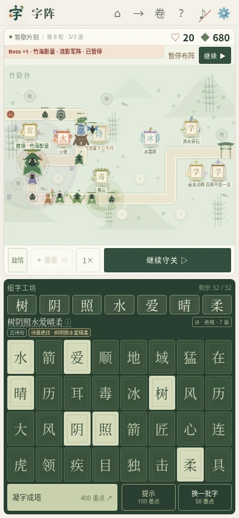

<p align="center">
  
</p>

<h1 align="center">字阵 / WORDWARD</h1>

<p align="center">把汉字、成语和古诗句变成防御塔，落字成阵，守一卷山河。</p>

<p align="center">
  <a href="https://game.polishwb1020.com/">立即体验</a> ·
  <a href="#主要玩法">主要玩法</a> ·
  <a href="#界面预览">界面预览</a> ·
  <a href="#本地运行">本地运行</a>
</p>

最初是想给孩子做个能边玩边认识汉字、词语和成语的小游戏。后来又加上古诗句，希望孩子在琢磨怎么布阵时，也愿意看看一个词是什么意思、一句诗描写了什么。

## 主要玩法

- **组词成塔**：按正确顺序选择 1—7 张字牌，组成词语后落塔。每张牌只能用一次，重复字需要分别备牌。
- **随机字库**：每批 32 张牌，保底备足 1 句完整诗、2 个不同四字词和 3 个不同三字词；剩余位置按概率加入完整组合，也可能再抽到诗句。
- **词义决定打法**：毒箭远程施毒，毒云留下持续毒域，火墙铺出地焰；滴水穿石越打越能破甲，画龙点睛可以显形并强化友塔。
- **诗句成章**：109 首古诗词、483 条完整诗句，蓄满诗韵后释放诗意绝技与持续诗境。“飞流直下三千尺”会唤出沿路线奔涌的瀑流，其他诗句还可提供冻结、护盾、修复等能力。
- **按年级学习**：可选一年级到六年级的累计诗词范围。选择二年级，就只出现一、二年级的诗句；词典可查看原诗、作者、句意和游戏效果。
- **三十章山河**：三卷、三十张主题地图，包含桃源、古寺、海湾、星海等场景，各章有不同路线和特色兵种，支持轮番或同时多入口；214 类怪物中包含 112 种小怪与 102 种 Boss，通关后还可继续挑战无尽模式。
- **怪物也会攻塔**：沿途敌人会主动攻击词塔，需要在建造、升级、修复、重建与换牌之间分配墨点。暂停时也能组词和调整布阵。

词典会区分成语、普通词语和游戏技能词，学习释义与战斗效果分别展示。相近词可以共享机制，不是每个名字都有一套完全不同的攻击。

完整章节、当地兵种和存档兼容说明见 [三十章战役](docs/CAMPAIGN.md)。

## 界面预览

桌面端展开地图和组字工坊；手机竖屏将战场与字库放在一屏里，短横屏自动调整布局。


<table>
  <tr>
    <th>手机组词布阵</th>
    <th>诗句与学习释义</th>
    <th>诗词年级范围</th>
  </tr>
  <tr>
    <td></td>
    <td></td>
    <td></td>
  </tr>
</table>

截图来自实际游戏页面，使用预置演示战局展示功能；示例阵容不代表初始资源或自然抽牌结果。见[截图说明](docs/screenshots/README.md)。

## 开始玩

1. 打开 [在线游戏](https://game.polishwb1020.com/)，进入「组词守关」。
2. 按词序选字，点击「凝字成塔」，再点地图上的空阵位。
3. 迎战墨影，用过关所得墨点升级、修缮、解锁阵位或换一批字。
4. 想放慢节奏时暂停布阵；点击词语或已有塔，可以查看释义、攻击效果和升级选项。

在 **设置 → 诗词年级范围** 中选择学习范围，自动包含更低年级。选择会保留，保底与额外诗句、提示和词典均遵守范围；下一次换牌或新开局按新范围发牌。

支持手机、平板和桌面浏览器，也可添加到手机主屏幕独立打开。无需登录，战局、星级和设置保存在当前浏览器；暂未提供跨设备同步。

## 本地运行

需要 **Node.js 20+** 和 **Python 3**。游戏是静态网页，没有运行时服务端，也不需要安装前端依赖。

```sh
git clone https://github.com/polish1020/zi-zhen.git
cd zi-zhen

node scripts/build-static.mjs
python3 -m http.server 4173 --directory public
```

浏览器打开 <http://localhost:4173>。构建会检查诗词数据并生成 `public/`；修改 `dist/` 中的源码后，重新构建并刷新页面。

运行逻辑测试：

```sh
node --test tests/*.test.mjs
```

<details>
  <summary>浏览器回归与发牌审计</summary>

浏览器回归使用 Playwright Core 与 Chromium / WebKit。现有 `.cjs` 脚本包含执行环境内的模块和浏览器路径，需先按本机安装位置调整；逻辑测试不需要浏览器。

预览服务保持运行，在另一个终端执行：

```sh
BASE_URL=http://127.0.0.1:4173 node tests/hand-guarantees.cjs
BASE_URL=http://127.0.0.1:4173 node tests/poetry-grades.cjs

node scripts/audit-hands.mjs
node scripts/audit-poetry-grades.mjs
```

更多范围、方法和历史结果见[测试说明](docs/TESTING.md)。自动策略的模拟通关率不等同于真实玩家胜率。

</details>

## 部署与移动端

Vercel 配置已包含在仓库中，导入项目后使用：

| 配置项 | 值 |
|---|---|
| Framework Preset | Other |
| Build Command | `node scripts/build-static.mjs` |
| Install Command | 留空 |
| Output Directory | `public` |

也可以把生成的 `public/` 部署到支持静态文件的托管服务。现有生产项目已关联本仓库，推送 `main` 会自动发布。

仓库提供 Capacitor 配置和 `python3 scripts/prepare-mobile.py` 本地资源打包脚本，原生 Android / iOS 应用仍处于准备阶段，尚未提供安装包。PWA 的主屏幕启动支持也不代表已实现离线缓存。

## 开发文档

| 内容 | 文档 |
|---|---|
| 发牌保底、随机组合与一次性字牌 | [字库与发牌](docs/HANDS.md) |
| 诗塔、诗意绝技与持续交互 | [诗句成塔](docs/POETRY.md) · [诗境机制](docs/POETRY-SCENES.md) |
| 按年级选择学习范围 | [诗词年级](docs/POETRY-GRADES.md) |
| 词语分类、成语与词义维护 | [词库维护](docs/VOCABULARY.md) · [成语机制](docs/IDIOMS.md) |
| 怪物攻塔、维修与资源取舍 | [攻塔与守备](docs/SIEGE.md) · [经济系统](docs/ECONOMY.md) |
| 部署与移动应用准备 | [Vercel](docs/DEPLOYMENT-VERCEL.md) · [IGA Pages](docs/DEPLOYMENT-IGA.md) · [移动端封装](docs/MOBILE-APP.md) |

源码集中在 `dist/`，词库与诗词内容在 `data/`，构建和审计脚本在 `scripts/`，测试在 `tests/`。`public/` 和 `mobile/www/` 为生成目录，不提交。

偏旁造字、自由造物和练字小径仍在实验阶段，首页入口暂时隐藏，相关代码与独立存档保留。

## 反馈与素材来源

欢迎反馈缺失的常见词、成语或诗词归类、手机显示问题，以及好玩或过强的组合。报告问题时，附上设备与浏览器、章节和轮次、相关词塔与截图，会更方便复现。

常用词数据部分来自 [jieba](https://github.com/fxsjy/jieba)，项目另有人工整理的成语、文化词、技能词与诗词配置。第三方词库与笔顺素材的来源及许可见[第三方声明](dist/THIRD-PARTY-NOTICES.txt)和[笔顺素材许可](dist/ARPHICPL.TXT)。
